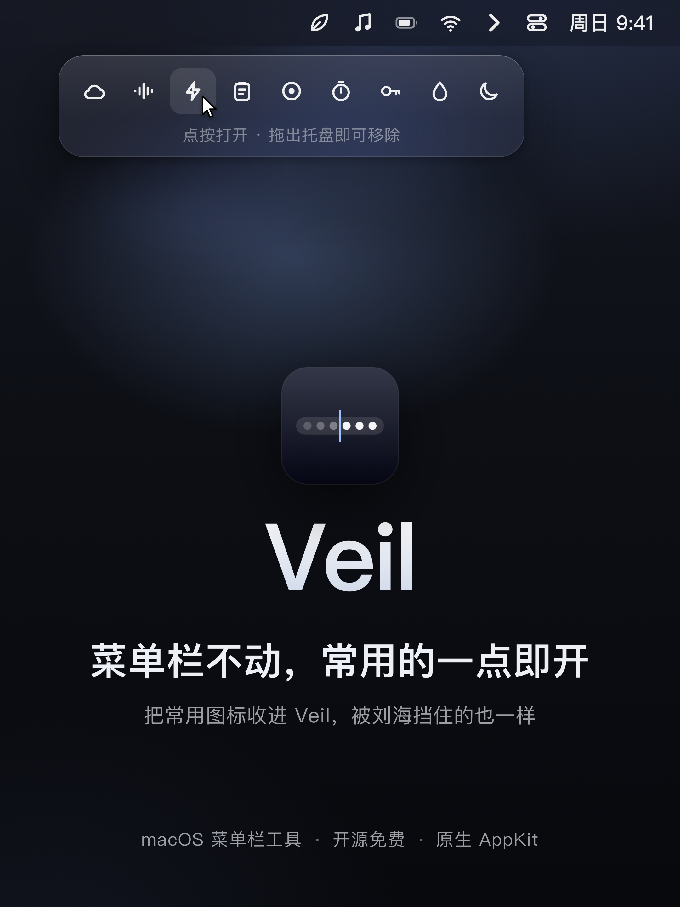
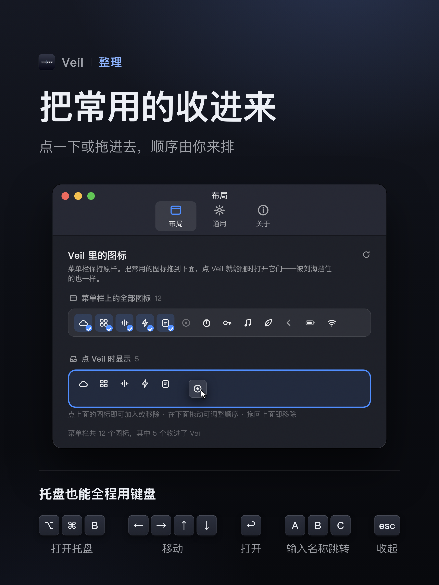
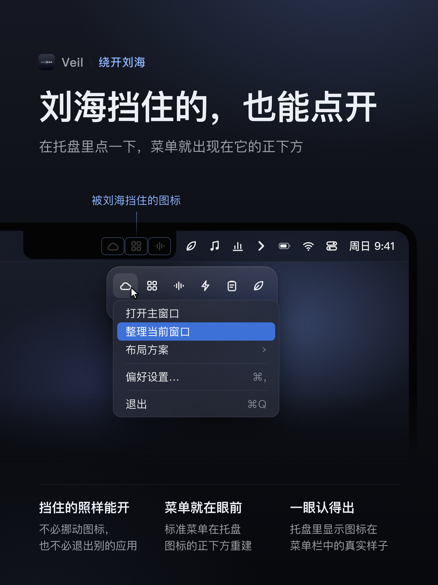

# Veil

[English](README.md) | **简体中文**

Veil 是一个 macOS 菜单栏小工具：把常用的菜单栏图标收进 Veil，点一下就能打开，被 MacBook 刘海挡住的也一样。它不隐藏、不挪动任何图标，菜单栏保持原样。你挑出常用的图标，点 Veil 自己的菜单栏图标，就会落下一个托盘，从托盘里点开对应应用的菜单或弹出面板。



## 功能

- **你挑选的图标托盘。** 点 Veil 图标落下托盘，里面按你排好的顺序显示收进来的图标，太多时自动折行。
- **绕开刘海。** 被刘海挡住的图标也能从托盘里打开。
- **菜单出现在托盘下方。** 标准的状态栏菜单会在托盘图标正下方重建为一份原生菜单；弹出面板（`NSPopover`）会在水平方向挪到对准托盘图标的位置。
- **图标的真实外观。** 有「屏幕录制」权限时，Veil 截取每个图标在菜单栏里的真实样子，显示在托盘和设置里。单色图标跟随深浅色模式，彩色图标保留原色。没有这个权限时显示应用图标。
- **多种打开方式：** 点按 Veil 图标、按全局快捷键（默认 ⌥⌘B，可在设置里改），或把指针放在菜单栏上向下滚动（可关闭）。
- **拖放整理：** 在 设置 › 布局 里拖动即可收进、排序、移除。
- **Veil 图标四种样式**（箭头、眼睛、圆点、线条），可设置登录时打开。

## 截图

| 设置 › 布局 | 绕开刘海 |
| --- | --- |
|  |  |

## 下载安装

1. 下载 [Veil-1.0.2-macos-arm64.zip](https://pan.quark.cn/s/f415f22870ca)（夸克网盘，永久有效）。打开链接后进入 Veil 文件夹，下载这个 zip。
2. 解压后把 **Veil.app** 拖进「应用程序」（`/Applications`）。
3. 打开 Veil。首次启动会打开设置窗口，可以在那里授予下面的权限。

请把 Veil 放在 `/Applications` 里使用：系统的隐私权限和登录项都和应用的位置、签名绑定。

## 权限与隐私

Veil 需要在 系统设置 › 隐私与安全性 里授予两项权限。

| 权限 | 用途 |
| --- | --- |
| **辅助功能**（必需） | 列出正在运行的应用的菜单栏图标、读取它们的菜单，并在你使用托盘时替你点按图标和菜单项。没有它托盘无法打开。 |
| **屏幕录制**（可选） | 截取菜单栏图标的真实外观。Veil 只截取菜单栏那一条，从中裁出每个可见的图标，以 PNG 保存在 `~/Library/Caches/net.bytenote.veil/`。没有这个权限时托盘显示应用图标。 |

**隐私声明：** 截取的图标图片只保存在本机上面的缓存目录里。Veil 的源代码里没有任何联网代码（没有 `URLSession`、socket 之类），不会上传或发送任何数据。设置和你收进 Veil 的图标列表保存在 Veil 自己的偏好设置（user defaults）里。缓存目录可以随时删除，图标下次出现在屏幕上时会重新截取。

全局快捷键使用 Carbon 热键 API，不需要额外权限。

## 使用方法

- **收进图标：** 打开设置（右键 Veil 图标 › 「整理 Veil 里的图标…」，或在访达里再次打开 Veil），进入「布局」。上面列出菜单栏上的全部图标（只是挑选器，真实菜单栏不会被改动），点按图标或把它拖到下面，就收进了 Veil。
- **排序 / 移除：** 在下面拖动调整顺序；拖回上面，或在上面再点一次，即可移除。
- **打开托盘：** 点按 Veil 图标、按 ⌥⌘B，或在菜单栏上向下滚动。在菜单栏上向上滚动、点其他地方或按 Esc 收起。
- **托盘里：** 点按图标打开它的菜单；把图标拖出托盘即从 Veil 移除；右键图标有「打开」和「从 Veil 移除」。
- **Veil 图标的菜单：** 右键（或按住 Control 点按）Veil 图标，可以打开设置或退出。

## 系统要求

- macOS 14 Sonoma 或更新版本
- Apple 芯片（M 系列）的 Mac（发布包只有 arm64）

Veil 主要在 macOS 27 上测试。理论上支持 macOS 14 及以上，但较旧的系统测试得较少。

## 已知限制

- **Veil 不隐藏图标。** 它不是 Bartender、Ice 那类隐藏菜单栏图标的工具。所有图标都留在真实的菜单栏里，Veil 只是给你另一个打开它们的入口。
- **镜像菜单是简化版。** 能通过辅助功能读到的菜单，Veil 会在托盘下方弹出一份原生菜单副本。副本保留标题、可用状态、勾选标记、快捷键和子菜单，但**会丢掉菜单项的图标和自定义视图**（滑块、开关、富内容行等）。选中某项时，Veil 再替你点原菜单里的对应项。
- **部分菜单和窗口仍出现在原位置。** 如果菜单全是自定义视图（读不到文字可镜像），或者应用弹出的不是标准菜单或弹出面板（比如它自己的自定义窗口），Veil 会真的点一下原图标，界面出现在应用自己决定的位置，可能就在刘海旁边或被刘海挡住。
- **弹出面板只做水平对齐。** 垂直位置保持系统给的位置。
- **图标外观可能是旧的。** 图标只有真正显示在屏幕上时才能截到，所以被刘海挡住的图标显示的是上次截到的样子，从没截到过就显示应用图标。菜单栏隐藏时（全屏、自动隐藏）不会截取。
- **本机自行构建的版本**在没有 Developer ID 证书时是 ad-hoc 签名，每次重新构建后系统可能要求重新授予权限。

## 从源码构建

需要 Apple 芯片的 Mac 和支持 Swift 6 的 Xcode（`swift-tools-version:6.0`）。

```bash
./build.sh
```

它会编译 release 版本、组装 `build/Veil.app`、签名（优先用钥匙串里第一个「Developer ID Application」证书，设置了 `VEIL_SIGN_ID` 时用它，否则 ad-hoc），然后安装到 `/Applications/Veil.app`（会先退出正在运行的 Veil）。

环境变量：

| 变量 | 作用 |
| --- | --- |
| `VEIL_NO_INSTALL=1` | 只生成 `build/Veil.app`，不动 `/Applications`。 |
| `VEIL_BUILD=<n>` | 构建号（`CFBundleVersion`）。默认取 `git rev-list --count HEAD`，不在 git 仓库里时为 `1`。 |
| `VEIL_SIGN_ID=<证书>` | 指定签名证书。 |

版本号在 `VERSION` 文件里，`Info.plist` 模板在 `Resources/Info.plist.in`。

**应用图标：** 构建使用仓库里的 `Resources/AppIcon.icns`。`Scripts/make-icon.swift` 是绘制它的工具，修改脚本后这样重新生成：

```bash
swift Scripts/make-icon.swift build/AppIcon.iconset
iconutil -c icns build/AppIcon.iconset -o Resources/AppIcon.icns
```

## 许可证

Veil 是自由软件，以 [GNU 通用公共许可证第 3 版](LICENSE)（GPL-3.0）发布。版权所有 © 2026 Veil contributors。

更新记录见 [CHANGELOG.md](CHANGELOG.md)。
